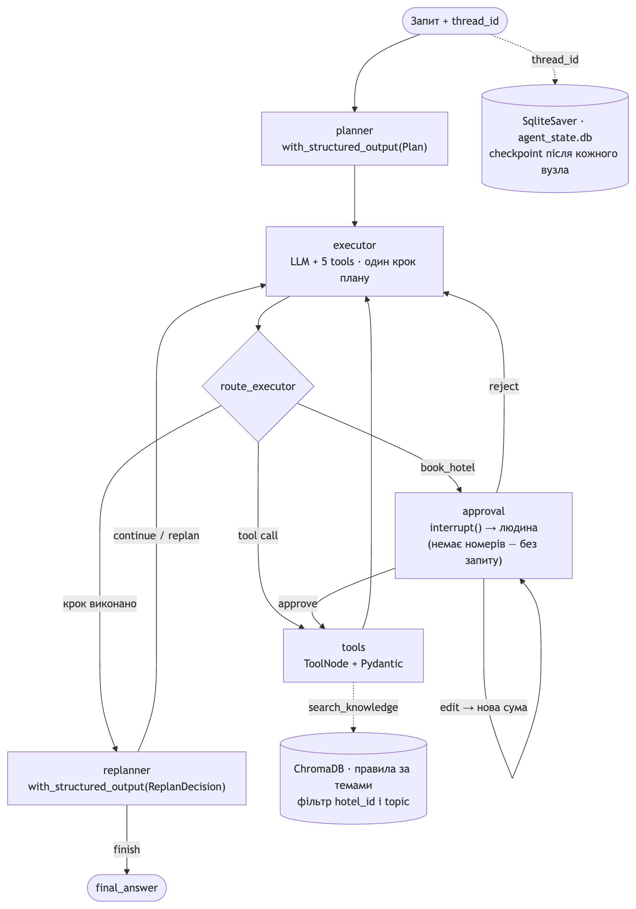

# Plan-and-Execute агент бронювання готелів

Це продовження ДЗ1. Домен той самий: пошук і бронювання готелів у Києві, Львові та Одесі (mock-дані 9 готелів), і 4 tools з ДЗ1 перевикористані. Замість ReAct-циклу агент тепер спершу складає план, потім виконує його по кроках і після кожного кроку вирішує, що робити далі.

Додатково в проєкті є збереження стану в SQLite, база знань у ChromaDB, з якою агент працює як з окремим tool, і підтвердження людиною перед бронюванням.

Модель: OpenAI `gpt-6-luna`, ембединги: `text-embedding-3-large`.

## Архітектура



Граф складається з п'яти вузлів.

- `planner` отримує запит і через `with_structured_output(Plan)` повертає ціль і від 1 до 5 кроків. Кожен крок пишеться як «інструмент: що зробити», з датами, ID готелю й кількістю гостей. Planner бачить попередні повідомлення треду, тому розуміє запити на кшталт «скільки він коштуватиме».
- `executor` виконує один крок. Він викликає LLM з tools, і поки модель просить tool, граф ходить між `executor` і `tools`. Коли модель відповідає текстом, крок вважається виконаним, а висновок разом із виходами tools зберігається в `results`.
- `tools` це стандартний `ToolNode`. Помилки валідації Pydantic повертаються моделі як повідомлення, і вона може виправити аргументи.
- `approval` спрацьовує лише для `book_hotel` і зупиняє граф для підтвердження (див. розділ про HITL).
- `replanner` через `with_structured_output(ReplanDecision)` обирає одне з трьох: `continue`, `replan` (замінити кроки, що залишились) або `finish` (з фінальною відповіддю).

Обидві моделі описані в `plan_execute.py`: `Plan(goal, steps)` і `ReplanDecision(reasoning, action, updated_steps, final_answer)`. У стані графа зберігаються `messages`, `goal`, `plan`, `current_step`, `results`, `completed`, а також службові `step_messages` і `decision`.

Planner складає план для основного сценарію і не додає перевірок «про всяк випадок». Якщо результат кроку показує проблему (наприклад, у найдешевшому готелі немає сніданку), план змінює replanner. Перед завершенням replanner перевіряє, що виконано всі умови запиту.

## Запуск

```bash
cd hw2_plan_execute
python3 -m venv .venv && source .venv/bin/activate && pip install -r requirements.txt
cp .env.example .env               # OPENAI_API_KEY=sk-...
pytest -v                          # тести; частина з них потребує ключа для ембедингів
python demo.py                     # 15 демо-сценаріїв, результат у demo_results.json
python plan_execute.py --thread t1 "Забронюй LVI-001 з 10 по 12 березня 2027 на двох на Іван Петренко, ivan@example.com"
python plan_execute.py --thread t1 # продовжити тред після падіння або після запиту на підтвердження
```

## Збереження стану (Завдання 2)

Checkpointer підключений так: `SqliteSaver(sqlite3.connect("agent_state.db", check_same_thread=False))` передається в `graph.compile(checkpointer=...)`. Стан зберігається у файл після кожного вузла, а сесію визначає `thread_id`.

Відновлення перевіряється у сценарії PERSIST-CRASH двома окремими процесами. Перший процес виконує перший крок плану й аварійно завершується через `os._exit(1)`, тобто без закриття бази. Другий процес читає стан тим самим `thread_id` і продовжує:

```
процес 1: planner → executor → tools → executor → replanner → os._exit(1)
процес 2: get_state → current_step=1, next=['executor'], план з 4 кроків той самий
          1. search_hotels: готелі в Одесі на 2027-07-01 – 2027-07-04 для 3 гостей (виконано)
          2. get_hotel_details  3. calculate_total_price  4. search_knowledge: документи для заселення
процес 2: stream(None) → executor → ... → replanner (planner повторно не запускався)
відповідь: ODS-001 Arcadia Beach Resort, 14550 грн зі сніданком і збором, плюс перелік документів
```

Незалежність сесій показують сценарії THREAD:

| Тред | Запит | Відповідь |
|---|---|---|
| `user-A` | «Знайди готель у Львові 2027-03-10 – 2027-03-12 на двох з найвищим рейтингом» | LVI-001 Rynok Square Hotel, рейтинг 9.1 |
| `user-A` | «Скільки він коштуватиме зі сніданком?» | 7120 грн, агент пам'ятає готель з попереднього запиту |
| `user-B` | те саме питання | просить уточнити готель, бо цей тред порожній |

## База знань і RAG (Завдання 3)

Факти про готелі (ціна, чи є сніданок, чи можна з тваринами, тариф скасування) лишились у tools з ДЗ1. У ChromaDB лежать текстові правила проживання. Колекція створюється через `PersistentClient("./chroma_db")`, тож ембединги зберігаються між запусками й перераховуються лише для змінених документів.

Кожен документ описує одну тему: або загальне правило мережі, або виняток для конкретного готелю.

- 13 загальних правил: заселення, документи, скасування, тварини, туристичний збір, оплата, депозит, безпека й укриття, відключення світла, як дістатися, сніданки, діти, поради щодо міст.
- 33 правила окремих готелів. Наприклад, у LVI-002 можна жити з двома тваринами по 200 грн за ніч, а в ODS-003 заселення з 15:00 і депозит 200 грн готівкою.
- У метаданих кожного документа є `topic`, `hotel_id` і `city`. Загальні правила мають `hotel_id = "ALL"`.

Tool `search_knowledge(query, hotel_id=None, topics=None)` працює так:

1. Фільтрує документи за метаданими. Без `hotel_id` шукає лише серед загальних правил, з `hotel_id` додає правила цього готелю. Правила інших готелів у результат не потрапляють.
2. Рахує косинусну схожість запиту з усіма відфільтрованими документами.
3. Якщо в готелю є власне правило на тему, воно замінює загальне правило цієї теми.
4. Кількість результатів залежить від запиту. Якщо модель передала `topics`, повертаються правила всіх цих тем. Якщо ні, повертаються документи з релевантністю від 0.35 і не гіршою за найкращий результат більше ніж на 0.1, але не більше п'яти. Поріг підібраний на 27 розмічених запитах скриптом `calibrate_rag.py`.

`get_hotel_details` не повторює текст правил, а лише перелічує теми, для яких у готелю є власні правила. Тести перевіряють, що правила не суперечать даним у `tools.py`: наприклад, «тварини не допускаються» написано саме там, де в даних `pets = False`.

Ні граф, ні окремий router не змушують агента звертатися до бази знань, він вирішує сам:

| Сценарій | Запит | Що викликав агент | Результат |
|---|---|---|---|
| RAG-KNOWLEDGE | «О котрій заселення й виселення і які документи потрібні?» | `search_knowledge` | 14:00 / 12:00, паспорт; tools готелів не викликались |
| RAG-TOOLS | «Порахуй повну вартість LVI-001 … зі сніданком» | `calculate_total_price` | 7120 грн; база знань не потрібна |
| RAG-MIXED | «Їду до Львова з собакою… поясни правила» | `search_hotels`, `get_hotel_details`, `search_knowledge` | LVI-002 і його правило: до 2 тварин, 200 грн за ніч |
| RAG-OVERRIDE | «Заселення й депозит у ODS-003?» | `search_knowledge` з `hotel_id` | 15:00 / 11:00 і 200 грн замість загальних 14:00 / 12:00 і 500 грн |

## Human-in-the-Loop (Завдання 4)

Ризиковий tool тут `book_hotel`: бронювання не можна скасувати автоматично, а модель може помилитися в датах чи кількості гостей.

Коли executor викликає `book_hotel`, граф переходить не в `tools`, а у вузол `approval`. Там викликається `interrupt()`, і людина бачить, що саме буде заброньовано:

```
LVI-001 Rynok Square Hotel (Львів), 2027-03-10 – 2027-03-12 (2 ноч.), гостей: 2, номерів: 1, сніданок: ні,
гість: Іван Петренко <ivan.petrenko@example.com>, до сплати 6000 грн, скасування: безкоштовне до 48 год до заїзду
```

Граф продовжується через `app.invoke(Command(resume=...), config)`:

| Відповідь | Що відбувається | Результат у демо |
|---|---|---|
| `{"action": "approve"}` | бронювання виконується | код BK-5E9F2A, 6000 грн |
| `{"action": "reject", "reason": "Клієнт передумав"}` | tool не виконується, executor отримує повідомлення про відмову | нічого не заброньовано, агент пояснює причину і не пробує ще раз |
| `{"action": "edit", "args": {"breakfast": true}}` | аргументи змінюються, і людина бачить нову суму на повторне підтвердження | 7120 грн зі сніданком, після approve код BK-268BCD |

Якщо бронювання однаково неможливе (немає вільних номерів або аргументи невалідні), людину не питають, і `book_hotel` одразу повертає помилку.

`interrupt()` винесено в окремий вузол без виклику LLM. Після resume LangGraph запускає вузол спочатку, і якби interrupt стояв усередині executor, модель викликалася б ще раз і могла б повернути інші аргументи. Відповісти можна й пізніше, з іншого процесу: `python plan_execute.py --thread X` продовжить саме з місця зупинки.

## Результати

Усі 15 сценаріїв з `demo.py` пройшли. Траєкторії й перевірки збережені в `demo_results.json`.

| Сценарій | Що перевіряє | Кроків | Tools | Час, с |
|---|---|---|---|---|
| PLAN-SIMPLE | простий пошук | 1 | search_hotels | 9.1 |
| PLAN-MEDIUM | пошук і розрахунок | 2 | search_hotels, calculate_total_price | 14.7 |
| PLAN-REPLAN | зміна плану | 4, один replan | search_hotels, calculate_total_price, get_hotel_details ×2, calculate_total_price | 28.3 |
| RAG-KNOWLEDGE | довідкове питання | 1 | search_knowledge | 8.1 |
| RAG-TOOLS | розрахунок без RAG | 1 | calculate_total_price | 7.2 |
| RAG-MIXED | tools і RAG разом | 3 | search_hotels, get_hotel_details ×2, search_knowledge | 22.9 |
| RAG-OVERRIDE | правила готелю замість загальних | 1 | search_knowledge | 8.0 |
| PERSIST-CRASH | відновлення після падіння | 1 + 3 | search_hotels, потім get_hotel_details, calculate_total_price, search_knowledge | 29.8 |
| THREAD-A-1, A-2, B | незалежність тредів | по 1 | search_hotels, calculate_total_price, без tools | 8.7, 7.8, 6.0 |
| HITL-APPROVE, REJECT, EDIT | підтвердження бронювання | по 1 | book_hotel | 8.8, 8.5, 9.6 |
| HITL-SOLDOUT | готель без вільних номерів | 1 | book_hotel без запиту людині | 8.8 |

## Аналіз

Planner підбирає довжину плану під запит: один крок для простого пошуку, два для «знайти й порахувати», три-чотири, якщо треба ще й правила.

Replanner справді змінює план. У PLAN-REPLAN розрахунок для найдешевшого KYV-003 показав, що сніданку там немає, і replanner замінив решту кроків на пошук готелю зі сніданком. У результаті агент запропонував KYV-001 за 8000 грн. Після відмови оператора в HITL-REJECT replanner одразу завершив роботу і не пробував бронювати ще раз.

У всіх RAG-сценаріях агент правильно розрізнив, коли потрібні правила з бази знань, коли дані з tools, а коли і те, і інше. Теми й готель для пошуку він теж обирав сам.

Дати, суми й назви готелів записуються в одному форматі: `2027-03-10 – 2027-03-12`, `7120 грн`, `LVI-001 Rynok Square Hotel`. Tools форматують дані самі, у промптах є правила формату, а текст від моделі додатково проходить через `normalize()` з `formatting.py`, щоб формат не залежав від того, чи модель послухалась промпту.

Plan-and-Execute повільніший за ReAct: на кожен крок припадає щонайменше три виклики моделі, тож простий запит займає 9–17 секунд проти 5 у ДЗ1. Зате план видно в стані, його можна змінити за проміжними результатами, і між кроками є місце для підтвердження людиною.

Промпти зроблені статичними, а дата й прогрес передаються окремим повідомленням, тому працює кеш OpenAI. На запиті з PERSIST-CRASH з кешу читається 85–87% вхідних токенів (68% на першому запиті після зміни промптів). Для executor це близько 3960 токенів системного промпту й описів tools на кожному кроці.

Під час розробки трапилось кілька помилок, які довелося виправляти:
- executor просив підтвердження текстом замість виклику `book_hotel`;
- після edit модель бачила старі аргументи;
- стандартна модель ембедингів ChromaDB погано шукала українською;
- правила в базі знань суперечили даним готелів;
- пошук із вузьким фільтром іноді губив правило готелю;
- replanner інколи завершував роботу, коли варто було змінити план.

## Обмеження

- Дані тестові: кількість вільних номерів не змінюється після бронювання, лист і оплата не відбуваються.
- У `gpt-6-luna` не можна задати `temperature`, тому кількість кроків трохи відрізняється між запусками. Демо-перевірки дивляться на факти (ID готелів, суми, виклики tools), а логіку заміни плану окремо перевіряє тест із фейковою моделлю.
- Пошук без `topics` може промахнутися на дуже коротких питаннях, наприклад «о котрій заселення».
- Дати в сценаріях (2027 рік) доведеться оновити, коли вони стануть минулими.

## Файли

- `tools.py` — дані готелів і 4 tools з ДЗ1
- `knowledge.py` — база знань у ChromaDB і `search_knowledge`
- `plan_execute.py` — моделі `Plan` і `ReplanDecision`, стан, вузли, граф, SqliteSaver, CLI
- `hitl.py` — вузол підтвердження з `interrupt()`
- `formatting.py` — приведення тексту моделі до єдиного формату
- `calibrate_rag.py` — підбір порогу релевантності
- `demo.py`, `demo_results.json` — демо-сценарії та їхні результати
- `agent_state.db` — збережений стан демо-тредів
- `test_*.py` — тести
